<h1 align="center">Nithya</h1>

<p align="center"><strong>Ready-made looks for your apps. Browse the menu, choose a kit and its themes, and copy it in.</strong></p>

<p align="center">
  
  
  
  
  
  
</p>

<p align="center">
  <a href="#whats-inside">What's inside</a> ·
  <a href="#pick-one">Pick one</a> ·
  <a href="#the-kits">Kits</a> ·
  <a href="#patterns">Patterns</a> ·
  <a href="#how-it-works">How it works</a> ·
  <a href="#for-developers">For developers</a>
</p>

<p align="center">
  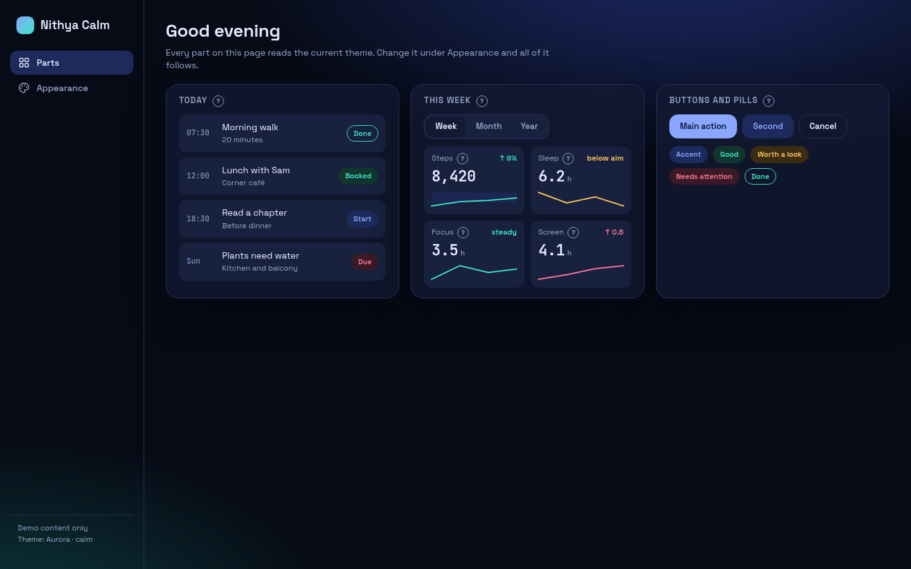
  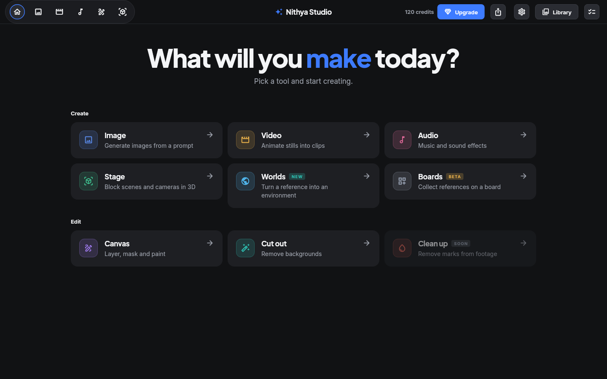<br>
  <sub>Two kits from the menu: Calm (Svelte) on the left, Studio (Flutter) on the right.</sub>
</p>

Nithya is a menu of design pieces for future apps. A design kit gives an app one consistent
look: its colours, fonts and sizes, its themes, and ready-made screen parts such as buttons and
cards. The menu also holds written-up *patterns*: good ideas you can reuse in any app. One
command lists everything by category. A second copies the kit you choose into your app, with
only the themes you want. Status: **research**. Kits are copied in, not installed as packages,
so each app owns its copy.

## What's inside

| Category | Count | What you choose |
| --- | --- | --- |
| 🧰 **Kits** | 2 | A whole design system for one or more runtimes. One per app. |
| 🎨 **Themes** | 9 | Which looks an app ships, and which one comes first (the default). |
| 🧩 **Components** | 34 | Screen parts. They come with their kit; the list shows what you get. |
| 💡 **Patterns** | 10 | Ideas to reuse anywhere, each written up with the code that does it. |

The menu lives in [`catalog.json`](catalog.json). Themes are read straight from each kit's
settings file, so the list is never out of date.

## Pick one

You need [Git](https://git-scm.com) and [Node.js](https://nodejs.org) 22.18 or newer.

**1. Get the code**

```sh
git clone https://github.com/sudharamachandranrajeev/nithya
cd nithya
```

**2. Browse the menu**

```sh
node nithya.mjs                  # everything, by category
node nithya.mjs list themes      # one category
node nithya.mjs show calm        # one item: what it is, where it lives, how to pick it
```

**3. Copy a kit into your app**

Name the kit, a new empty folder, and the themes you want. The first theme becomes the default.

```sh
node nithya.mjs pick calm ../my-app/ui --themes sage,journal
node nithya.mjs pick studio ../my-app/design --runtime flutter --themes dusk,daylight
```

Nithya never writes into a folder that already has files in it. Each pick leaves a `NITHYA.md`
in the new folder. It records what was picked and from which version, and lists the next steps
for that kit.

**4. Follow the next steps** printed by the pick, for example:

```text
Copied Calm (Svelte 5) to /home/you/my-app/ui
Themes: sage, journal (default sage)

Next:
  1. Add ../my-app/ui to your npm workspaces, then  npm install
  2. In main.ts:  import 'nithya-calm/base.css'  and  ui.start()  from 'nithya-calm'
  ...
```

## The kits

### Calm (Svelte 5)

A quiet, readable look for everyday apps, where people read more than they make. It is our
own design, first built for Arogya Swasthya.

- 🌗 **Every theme in light and dark.** Each theme can follow the device, or stay light or dark.
- 🔁 **One switch restyles everything.** Change the theme and every screen follows at once,
  with a soft cross-fade.
- 🫧 **Calm mode.** Follows the device's "reduce motion" setting, and stops every animation.
- 🖌️ **Make your own theme.** Users change colours, fonts and shapes with a live preview, then
  share it as text.
- ✅ **Text stays readable.** Every theme passes a contrast check (WCAG 2.2) before it can
  ship, and the editor warns in plain words.
- ❓ **A "?" on every number.** Explains what a figure means, in plain words.
- 📱 **Phone ready.** A side menu on wide screens becomes bottom tabs on phones.

| Sage | Aurora | Journal |
| --- | --- | --- |
| 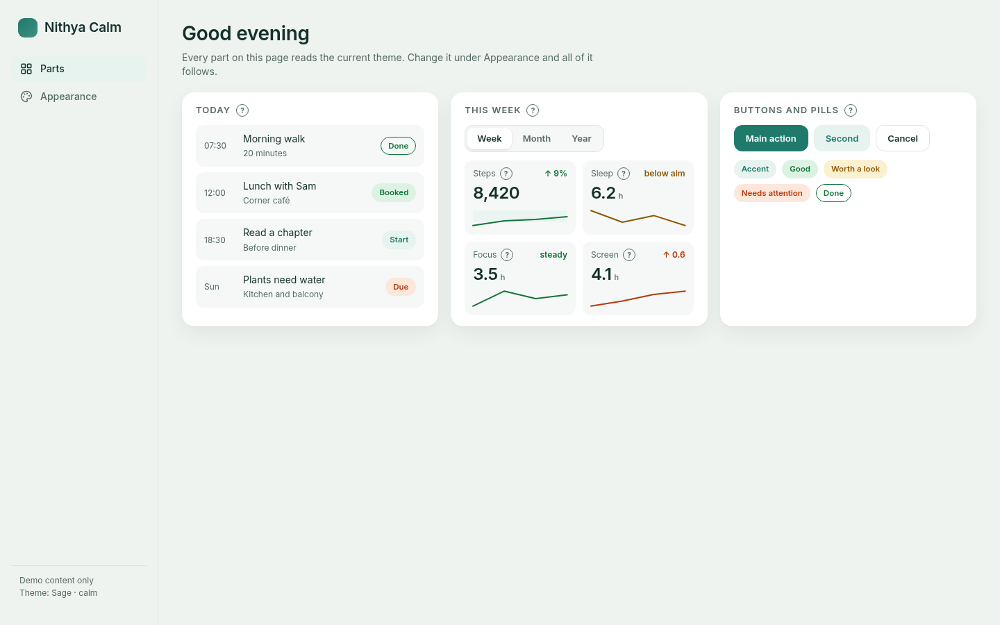 |  | 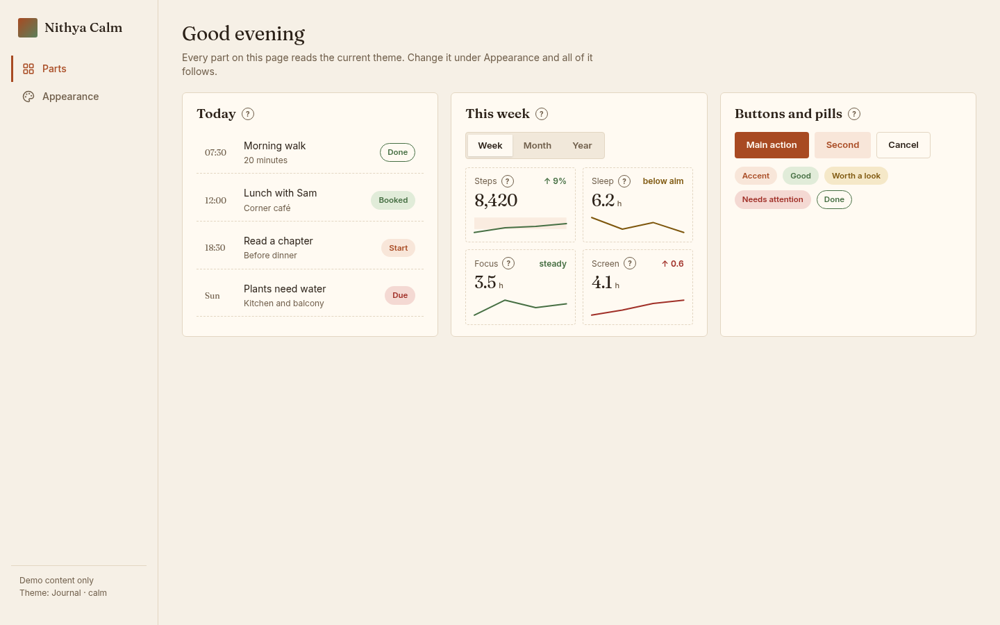 |
| **Sage, dark** | **Appearance page** | **Phone** |
| 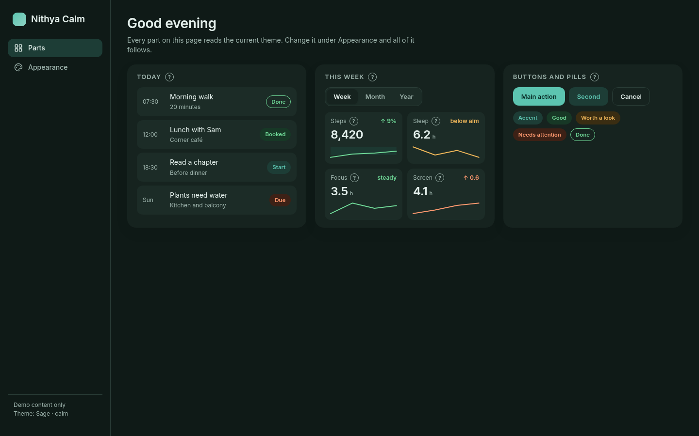 | 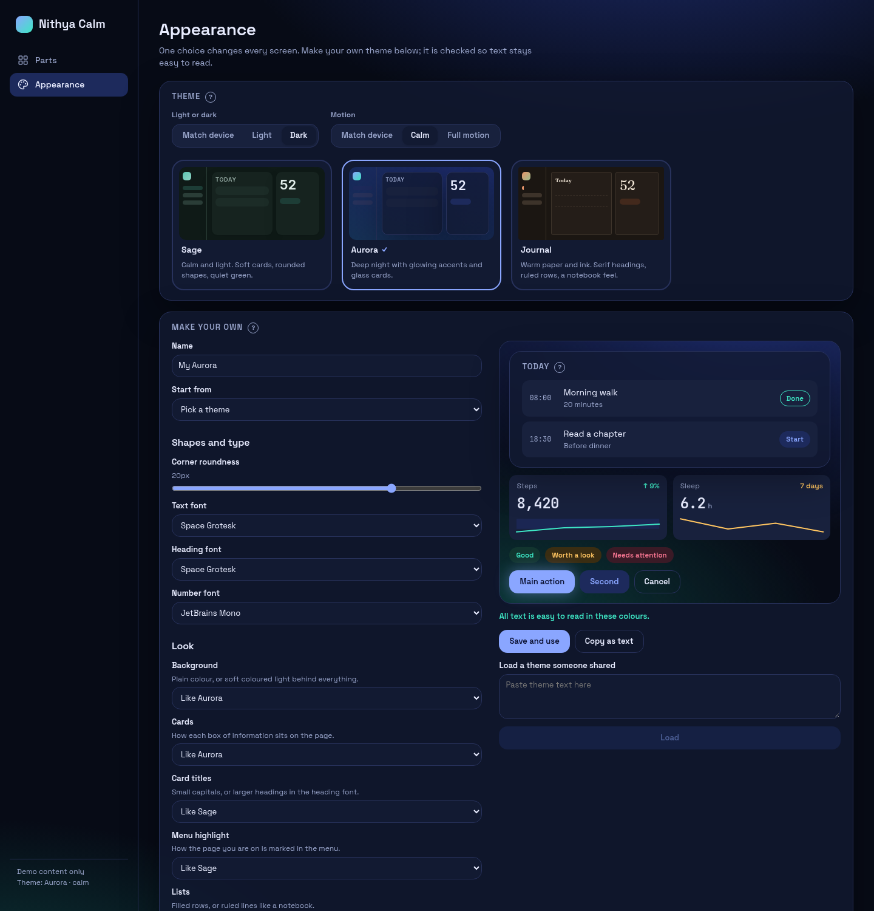 | 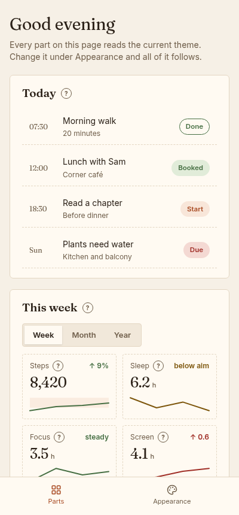 |

Try the demo page: `cd kits/calm && npm install && npm run dev`, then open
http://localhost:5175. The demo uses made-up content.

### Studio (Flutter and React)

A dark-first look for creative tools: a launcher, a prompt box, floating panels over a canvas.
It is built twice from one settings file, once in Flutter and once in React for Tauri.

| Feature | Preview |
| --- | --- |
| **Launcher.** A big headline, then a card for each tool. Badges mark tools as NEW, BETA or SOON. SOON cards cannot be clicked. |  |
| **Generate.** A prompt box with a slot for a reference picture and option chips. **Settings → General → Enter to generate** picks whether Enter sends. | 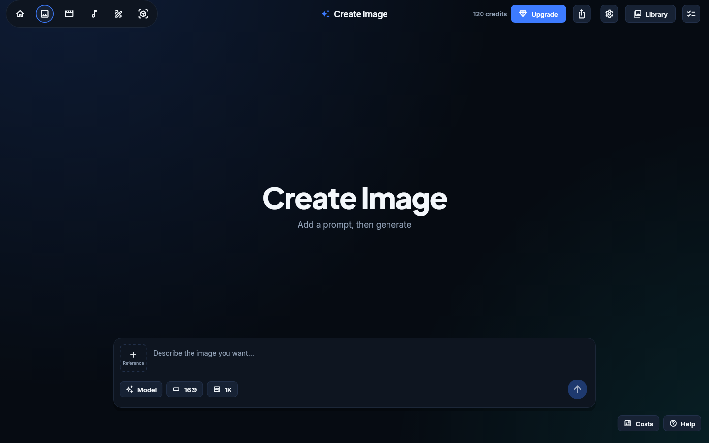 |
| **Stage.** Controls that float over a 3D view: a mode switch, a tool strip, a **Scene** panel and a playback bar. | 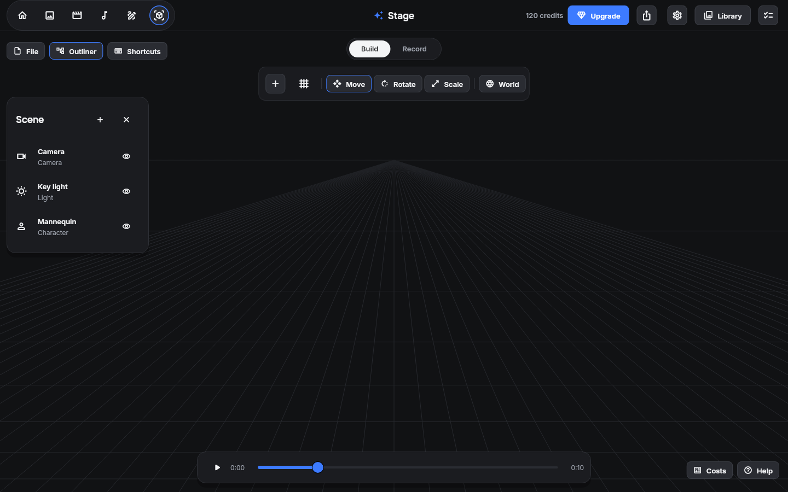 |
| **Same look in React.** The same settings file, drawn by the system's web engine inside a Tauri window. | 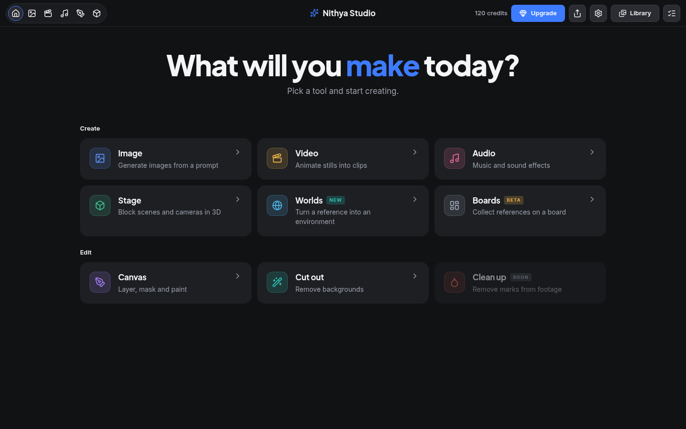 |

| Dusk (default) | Daylight | Graphite | Ink | Lagoon | Ember |
| --- | --- | --- | --- | --- | --- |
|  | 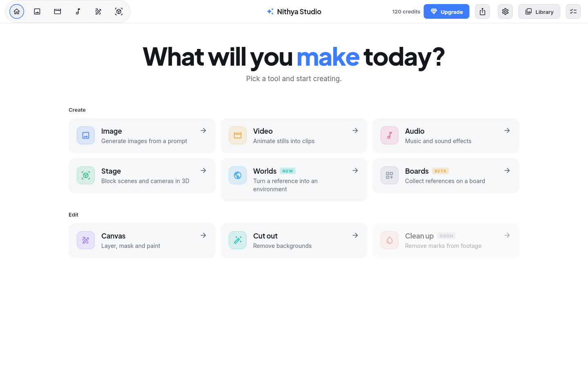 | 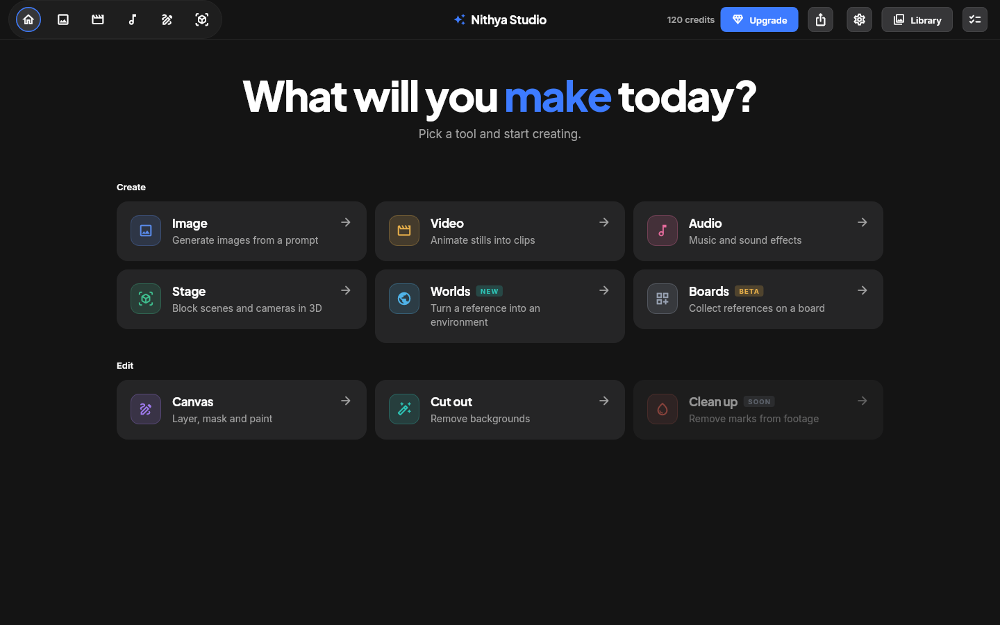 | 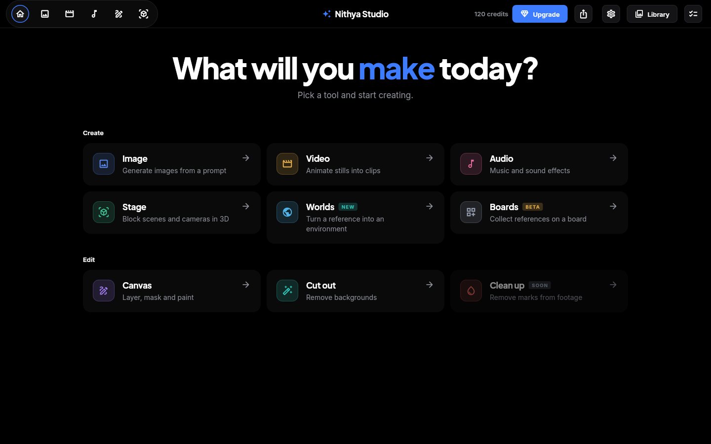 | 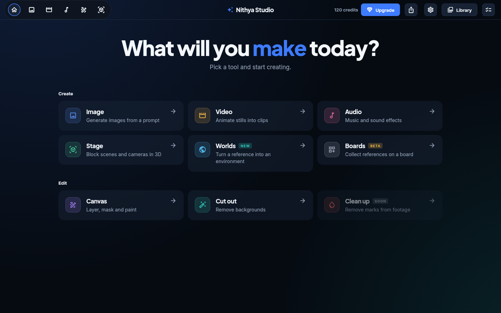 | 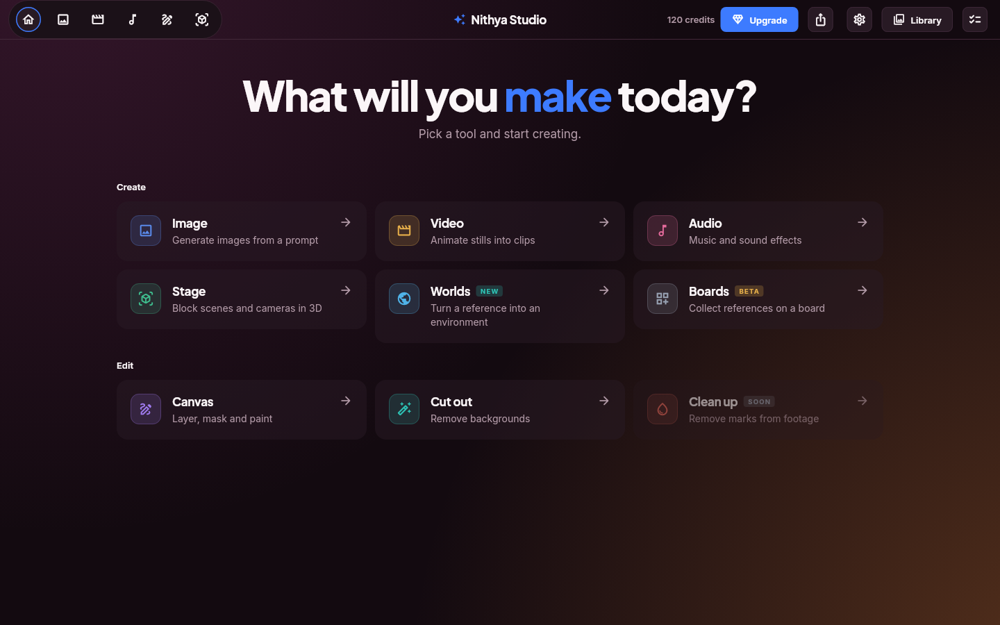 |

Studio also answers a research question: which runtime suits future apps? On one Linux laptop,
the same demo app was a 2.4 MiB `.deb` with Tauri against a 10 MiB `.tar.gz` with Flutter.
Flutter looks the same on every computer; Tauri depends on each computer's web view. The
verdict: existing Flutter apps stay on Flutter, and Tauri + web suits new desktop-first apps
heavy on media, canvas or 3D. The [viability report](docs/viability.md) has every number.

> [!NOTE]
> Known gaps in Studio: the NEW and BETA badge text is hard to read on Daylight (contrast
> 1.6–2.0:1), and the web dialog does not yet keep the Tab key inside it while open.

## Patterns

Read any of them with `node nithya.mjs show <id>`.

| Pattern | What it gives you | Kits |
| --- | --- | --- |
| [global-theme-switch](patterns/global-theme-switch.md) | One switch restyles every screen, cross-faded | Calm |
| [scoped-theme-preview](patterns/scoped-theme-preview.md) | True live previews of other themes, side by side | Calm |
| [calm-motion](patterns/calm-motion.md) | Follows "reduce motion"; one attribute stops every animation | Calm |
| [contrast-gate](patterns/contrast-gate.md) | Unreadable themes fail the build | Calm |
| [safe-theme-editor](patterns/safe-theme-editor.md) | User and shared themes that cannot inject code | Calm |
| [explain-everything](patterns/explain-everything.md) | A plain-words "?" beside every figure | Calm |
| [adaptive-shell](patterns/adaptive-shell.md) | Side menu on desktop, bottom tabs on phones, one list | Calm |
| [one-source-two-runtimes](patterns/one-source-two-runtimes.md) | One settings file feeds Flutter and the web | Studio |
| [glow-backdrop](patterns/glow-backdrop.md) | Soft coloured light behind the page, per theme | Studio, Calm |
| [enter-to-send](patterns/enter-to-send.md) | Users choose whether Enter sends | Studio |

## How it works

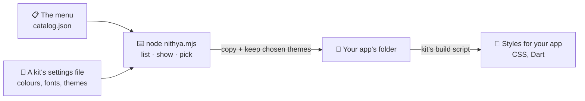

- **Kits live in `kits/`.** Each kit has one settings file. Designers call these values *tokens*.
- **A build script turns tokens into code.** Calm makes CSS; Studio makes Dart and CSS. Both
  fail with `--check` if a generated file is out of date.
- **Picking copies, then trims.** The copy keeps only your themes, in your order, and rebuilds.
  Build output, installed packages, demo apps and Studio's tests are left behind.

## For developers

<details>
<summary><strong>Run every test</strong></summary>

```sh
node --test 'test/*.test.mjs'                        # the menu matches the files; picks work (10)
cd kits/calm && npm install && npm test && npm run check   # Calm: 6 unit tests, types, tokens
cd kits/studio && node tokens/build.mjs --check      # Studio tokens up to date
cd kits/studio/flutter && flutter test               # 22 unit tests
cd kits/studio/flutter/example && flutter test       # 12 screen tests
cd kits/studio/web && npm install && npm test        # 23 unit tests
```

</details>

<details>
<summary><strong>Run the Studio demos</strong></summary>

```sh
cd kits/studio/flutter/example && flutter run -d linux   # or -d windows, or an Android device
cd kits/studio/web && npm run dev                        # then open http://localhost:5174
cd kits/studio/web && npm run tauri dev                  # as a desktop window (needs Rust and the Tauri prerequisites)
```

Add `?mode=4&theme=ember` to the web address to open a screen and theme directly.

</details>

<details>
<summary><strong>Re-render the screenshots</strong></summary>

Calm: `npm run build && npx vite preview` in `kits/calm`, then open the page with
`?theme=aurora&mode=dark&motion=calm#/parts` (or `#/appearance`) and capture it.

Studio: the Flutter screenshot test renders every screen in every theme.

```sh
cd kits/studio/flutter/example
NITHYA_SHOTS=../../../../docs/screenshots \
FLUTTER_ROOT=$(dirname $(dirname $(readlink -f $(which flutter)))) \
  flutter test test/screenshots_test.dart
```

</details>

<details>
<summary><strong>Add something to the menu</strong></summary>

1. Put a new kit in `kits/<id>/` with a token file and a build script.
2. Add it, its components and its patterns to `catalog.json`. Pattern notes go in `patterns/`.
3. Run `node --test 'test/*.test.mjs'`. It fails if a listed file is missing, a Calm component
   or pattern note is not listed, or a pick does not build.

</details>

## Clean room

The Studio kit was built without reading the studied app's source code. We looked only at its
published release and wrote down what it does in plain words; a separate build step worked only
from those notes. No file, text or screenshot of the studied app is in this repository. The
rules and the evidence list are in [docs/clean-room.md](docs/clean-room.md). The Calm kit is
our own design and needed no clean room.

## License

Apache-2.0. Fonts are under the SIL Open Font License: Inter and Plus Jakarta Sans in Studio
(licence files sit next to the fonts), and Inter, Space Grotesk, Fraunces and JetBrains Mono in
Calm (installed from Fontsource). Calm's icons come from Lucide (ISC licence).

---

> GitHub [@sudharamachandranrajeev](https://github.com/sudharamachandranrajeev)
