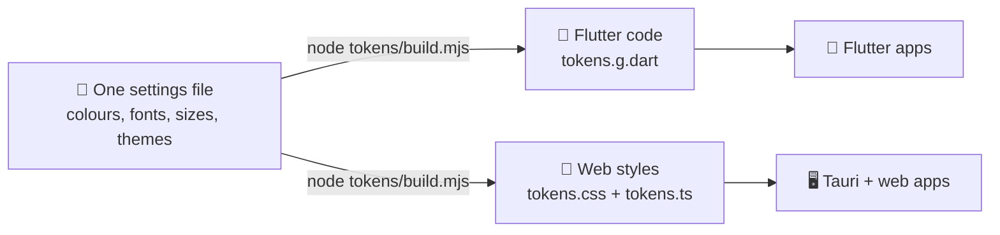

<h1 align="center">Nithya</h1>

<p align="center"><strong>One look for your apps, written once, that works in both Flutter and Tauri + web.</strong></p>

<p align="center">
  
  
  
  
  
</p>

<p align="center">
  <a href="#show-dont-tell">See it</a> ·
  <a href="#quick-start">Try it</a> ·
  <a href="#how-it-fits-together">How it works</a> ·
  <a href="docs/viability.md">Viability report</a> ·
  <a href="docs/clean-room.md">Clean-room process</a>
</p>

<p align="center">
  
  <br>
  <sub>The same launcher, built twice: Flutter on the left, Tauri + web on the right.</sub>
</p>

Nithya is a design framework: a set of colours, fonts, sizes and ready-made screen parts
(buttons, cards, dialogs) that give an app one consistent look. It exists to answer one question
before any real app depends on it: is Flutter or Tauri + web the better base for future apps?
So it builds the same framework twice, from one shared settings file. Status: **research**.
Nothing else uses it yet, and there is no app to download, only code to try.

## Show, Don't Tell

Every screen below uses only Nithya parts. The demo app, *Nithya Studio*, exists in both
runtimes. Its buttons are placeholders: it shows the look, it does not make images.

| Feature | Preview |
| --- | --- |
| **Launcher.** A big headline, then a card for each tool. Badges mark tools as NEW, BETA or SOON. SOON cards cannot be clicked at all. The grid reflows to fit the window. |  |
| **Generate.** A prompt box with a slot for a reference picture and option chips. The send button stays off until you type. In **Settings → General**, **Enter to generate** picks whether Enter sends. Shift+Enter always adds a new line. |  |
| **Canvas.** An empty drop area, then a **Canvas size** dialog. Sizes are grouped into Square, Landscape and Portrait, each with a preview. |  |
| **Stage.** Controls that float over a 3D view: a **Build / Record** switch, a tool strip, a **Scene** panel you can close and a playback bar. |  |
| **Settings.** A dialog with a list of sections down the side. **Appearance** switches between six themes as you click. |  |

### Same framework, web runtime

| Feature | Preview |
| --- | --- |
| **Launcher in React.** The same settings file and layout, drawn by the system's web engine inside a Tauri window. |  |
| **Glow themes in CSS.** Lagoon and Ember have soft coloured glows behind the page. On the web these are plain CSS gradients. |  |
| **Stage in React.** A floor grid, the tool strip, the **Scene** panel and a slider. |  |
| **Light theme.** Daylight uses the same screen parts. Only one setting changes. |  |

### Themes

| Dusk (default) | Daylight | Graphite |
| --- | --- | --- |
|  |  |  |
| **Ink** | **Lagoon** | **Ember** |
|  |  |  |

<sub>All screenshots are our own renders of the demo app, made by the screenshot test in
`flutter/example/test/` and the web build. None show the app that was studied.</sub>

## Runtimes

| Runtime | Folder | Draws with | Runs on | Tests | Status |
| --- | --- | --- | --- | --- | --- |
| Flutter | [`flutter/`](flutter) (`nithya`) | Its own engine (Skia / Impeller) | Android, Linux, Windows, macOS, iOS, web | 22 unit + 12 screen | Complete |
| Tauri + web | [`web/`](web) (`nithya-web`) | The system's web view | Linux, Windows, macOS (Tauri 2 also targets Android and iOS) | 23 unit, including a check of all 6 studio screens | Complete |

What we measured on one Linux laptop, for the same demo app:

- **Download size**: 2.4 MiB for Tauri (`.deb`) against 10 MiB for Flutter (`.tar.gz`).
  Tauri is smaller because it borrows the web view already on the computer.
- **Same look everywhere**: Flutter wins. It ships its own renderer, so it looks identical on
  every computer. Tauri's look depends on each computer's web view.
- **Verdict**: existing Flutter apps stay on Flutter. Tauri + web suits new desktop-first apps
  heavy on media, canvas or 3D.

Every number, and the reasons behind the verdict, are in the [viability report](docs/viability.md).

> [!NOTE]
> Two known gaps. The NEW and BETA badge text is hard to read on the light Daylight theme
> (contrast 1.6–2.0:1; the fix belongs in the settings file). The web dialog does not yet keep
> the Tab key inside it while open.

## How it fits together



- **One source.** Every colour, font, size and theme lives in
  [`tokens/nithya.tokens.json`](tokens/nithya.tokens.json). Designers call these values
  *tokens*.
- **One command.** `node tokens/build.mjs` turns that file into Dart code for Flutter and CSS
  for the web. Change a colour once and both runtimes change.
- **No stale copies.** `node tokens/build.mjs --check` fails if a generated file is out of date.
- **Fonts ship once.** Inter and Plus Jakarta Sans live in `flutter/assets/fonts`. The web build
  reads them from there.

## Quick start

You need [Git](https://git-scm.com). Then follow the steps for the runtime you want to try.

**1. Get the code**

```sh
git clone https://github.com/sudharamachandranrajeev/nithya
cd nithya
```

**2. Run the Flutter demo** (needs [Flutter](https://flutter.dev) 3.35 or newer)

```sh
cd flutter && flutter test              # check the framework
cd example && flutter run -d linux      # or -d windows, or an Android device
```

**3. Run the web demo in your browser** (needs [Node.js](https://nodejs.org) 22.12 or newer)

```sh
cd web
npm install && npm test
npm run dev                             # then open http://localhost:5174
```

Add `?mode=4&theme=ember` to the address to open a screen and theme directly (mode 0 is Home).

**4. Run the web demo as a desktop app** (also needs [Rust and the Tauri prerequisites](https://v2.tauri.app/start/prerequisites/))

```sh
cd web
npm run tauri dev                       # open a window
npm run tauri build -- --bundles deb    # or build a Linux package
```

The first Tauri build takes about four minutes while Rust compiles. Later builds are quicker.

## Using it in another app

**Flutter**

1. Add `nithya` to your `pubspec.yaml` as a path or git dependency.
2. Apply a theme: `MaterialApp(theme: nithyaTheme(nithyaPalettes['dusk']))`.
3. Read colours anywhere with `NithyaPalette.of(context)`.

**Web**

1. Copy or link the `web/src/nithya` folder into your app.
2. Import it once: `import { NithyaTheme } from './nithya'`.
3. Wrap your app in `<NithyaTheme theme="dusk">`.

Every part reads `--n-*` CSS variables, so it also works without React if you use the class
names in `nithya.css`.

<details>
<summary><strong>Full catalog</strong></summary>

### Tokens

| Group | Values |
| --- | --- |
| Fonts | display Plus Jakarta Sans, body Inter |
| Type | hero 60/800, title 28/800, heading 17/700, body 14/400, label 13/600, caption 12/400, overline 11/700 |
| Space | xxs 2, xs 4, sm 8, md 12, lg 16, xl 24, xxl 32, huge 48 |
| Radius | xs 4, sm 6, md 8, lg 12, xl 16, xxl 24, pill 999 |
| Size | top bar 56, control 36, tool tile 44, prompt dock 980, dialog 560, side nav 232, outliner 260 |
| Motion | fast 120 ms, base 180 ms, slow 280 ms |
| Accent | primary, on-primary, danger, success, warning |
| Hues | blue, amber, rose, green, sky, lime, slate, violet, red, teal |
| Badges | new = teal, beta = amber, soon = slate |
| Theme roles | background, panel, panel border, modal, controls, controls border, foreground, muted, divider, scrim, photo tint, photo grayscale, glow layers |
| Themes | Dusk (default), Daylight, Graphite, Ink, Lagoon (glow), Ember (glow) |

### Components

| Flutter | React | Role |
| --- | --- | --- |
| `nithyaTheme` + `NithyaPalette` | `NithyaTheme` | Apply a theme; palette is a `ThemeExtension` / CSS variables |
| `NithyaShell` | `Shell` | Top bar (modes, title, actions), body, corner actions; Tauri drag region and window buttons |
| `NithyaModeSwitcher` | `ModeSwitcher` | Pill of icon buttons for the working mode |
| `NithyaBackdrop` | `Backdrop` | Flat colour, glow layers, optional tinted grayscale photo |
| `NithyaButton` | `Button` | primary, secondary, ghost, danger; pill, large, expand |
| `NithyaIconButton` | `IconButton` | Icon-only; the label is required and becomes the accessible name |
| `NithyaChip` | `Chip` | Small toggle or option pill |
| `NithyaHero` | `Hero` | Centred headline with one accent word |
| `NithyaSectionLabel` | `SectionLabel` | Group heading |
| `NithyaIconTile` | `IconTile` | Hue-tinted icon square |
| `NithyaBadge` | `Badge` | NEW / BETA / SOON |
| `NithyaToolCard` | `ToolCard` | Launcher entry; SOON disables it |
| `NithyaToolGrid` | `ToolGrid` | Responsive grid, 300 px minimum column |
| `NithyaPromptDock` | `PromptDock` | Prompt field, options, send; Enter / Shift+Enter rules |
| `NithyaReferenceSlot` | `ReferenceSlot` | Dashed add-reference square |
| `NithyaPanel` | `Panel` | Floating surface with title, actions, close |
| `NithyaToolbar`, `NithyaToolbarDivider` | `Toolbar`, `ToolbarDivider` | Tool strip |
| `NithyaSegmented` | `Segmented` | Exclusive options pill |
| `NithyaDashedBox`, `NithyaDropZone` | `DashedBox`, `DropZone` | Empty states |
| `NithyaSelectTile` | `SelectTile` | Selectable preview with caption |
| `showNithyaDialog`, `NithyaDialog` | `Dialog` | Modal on the theme scrim |
| `NithyaSectionedDialog`, `NithyaSection` | `SectionedDialog`, `Section` | Settings-style dialog |
| `NithyaSwitchRow` | `SwitchRow` | Labelled switch with description |

</details>

<details>
<summary><strong>For developers: re-render the screenshots</strong></summary>

The Flutter screenshot test renders every screen in every theme. Without `NITHYA_SHOTS` it only
checks the screens, so it doubles as a smoke test.

```sh
cd flutter/example
NITHYA_SHOTS=../../docs/screenshots \
FLUTTER_ROOT=$(dirname $(dirname $(readlink -f $(which flutter)))) \
  flutter test test/screenshots_test.dart
```

`FLUTTER_ROOT` lets the test load the Material icon font. The web shots are taken from
`npm run dev` with the `?mode=` and `?theme=` address options.

</details>

## Clean room

Nithya was built without reading the studied app's source code. We looked only at its
published release and an offline copy of its interface, and wrote down what it does in plain
words. A separate build step then worked only from those notes. No file, text or screenshot of
the studied app is in this repository. Every claim in the [spec](docs/spec/creative-studio.md)
points to a recorded piece of evidence. The rules and the evidence list are in
[docs/clean-room.md](docs/clean-room.md).

## License

Apache-2.0. Inter and Plus Jakarta Sans are under the SIL Open Font License; their licence
files sit next to the fonts.

---

> GitHub [@sudharamachandranrajeev](https://github.com/sudharamachandranrajeev)
