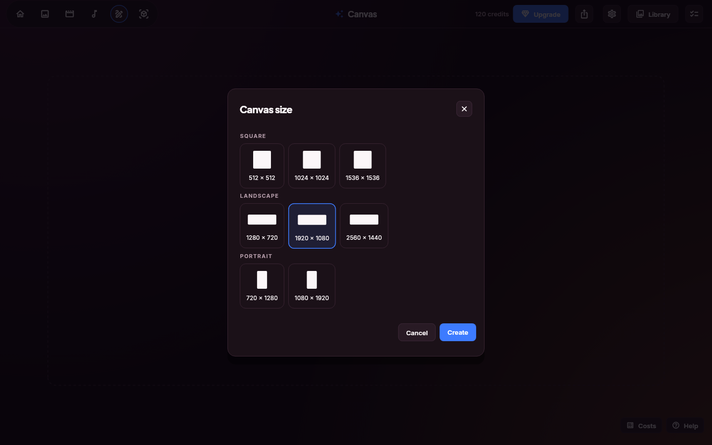
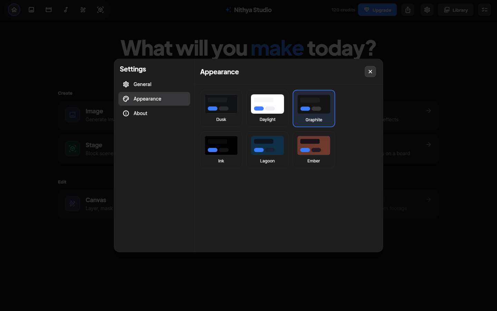
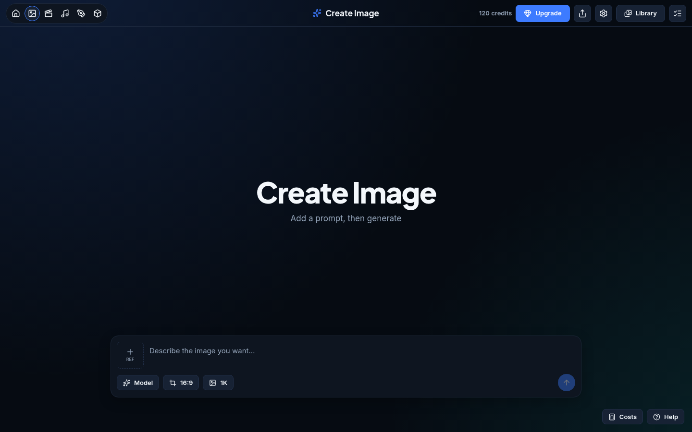
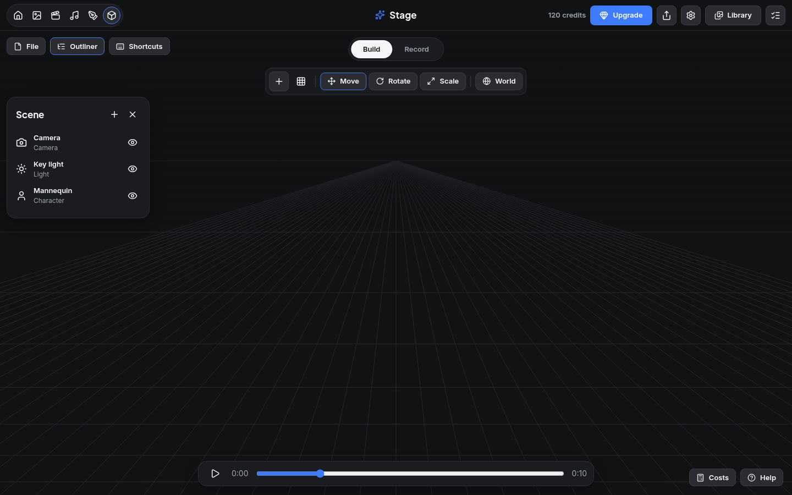
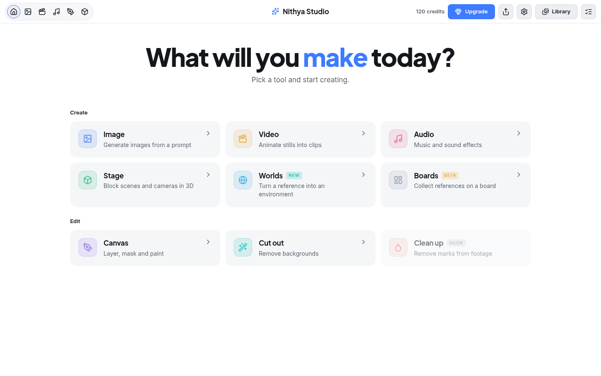

<h1 align="center">Nithya</h1>

<p align="center"><strong>One design framework, two runtimes: Flutter and Tauri + web, built from one token file.</strong></p>

<p align="center">
  
  
  
  
  
</p>

<p align="center">
  <a href="docs/viability.md">Viability report</a> ·
  <a href="docs/spec/creative-studio.md">Studio spec</a> ·
  <a href="docs/clean-room.md">Clean-room process</a> ·
  <a href="tokens/nithya.tokens.json">Tokens</a>
</p>

Nithya is a research project. It studies a shipped creative studio app as a black box, writes down what the interface does, and rebuilds that design language from scratch twice: once as a Flutter package, once as a React library inside a Tauri 2 shell. Both builds read one token file, so a colour, size or theme changes in one place. The goal is to measure whether either runtime is a sound base for future apps before any real app depends on it. Nithya is not part of any other project and nothing else uses it yet.

## Show, Don't Tell

Every screen below is assembled only from Nithya components. The same demo studio exists in both runtimes.

| Feature | Preview |
| --- | --- |
| **Launcher.** Hero with an accent word, tool cards with hue tiles and NEW / BETA / SOON badges, responsive grid. SOON cards are disabled, not just greyed. |  |
| **Generate.** Prompt dock with reference slot, option chips and a send button that stays disabled until there is text. Enter-to-send is a setting; Shift+Enter always adds a line. |  |
| **Canvas.** Empty-state drop zone, then a canvas size dialog with grouped, previewed sizes. |  |
| **Stage.** Floating chrome over a 3D viewport: segmented mode switch, tool strip, closable outliner panel and a transport bar. |  |
| **Settings.** Sectioned dialog with a side list. Appearance switches between six themes live. |  |

### Same framework, web runtime

| Feature | Preview |
| --- | --- |
| **Launcher in React.** Same tokens, same layout, rendered by the browser engine inside Tauri. |  |
| **Glow themes in CSS.** Lagoon and Ember are radial glow layers; the generator emits them as `background` gradients. |  |
| **Stage in React.** Canvas floor grid, toolbar, outliner and native range input. |  |
| **Light theme.** Daylight is the same component tree with one attribute changed. |  |

### Themes

| Dusk | Daylight | Graphite |
| --- | --- | --- |
|  |  |  |
| **Ink** | **Lagoon** | **Ember** |
|  |  |  |

## Runtimes

| Runtime | Package | Renders with | Targets | Tests | Status |
| --- | --- | --- | --- | --- | --- |
| Flutter | [`flutter/`](flutter) (`nithya`) | Skia / Impeller | Android, Linux, Windows, macOS, iOS, web | 22 unit + 12 screen | Complete |
| Tauri + web | [`web/`](web) (`nithya-web`) | System WebView | Linux, Windows, macOS (Android and iOS in Tauri 2) | 23 unit + screen smoke | Complete |

The measured trade-offs (bundle size, build time, accessibility, porting cost) are in the [viability report](docs/viability.md).

## How it fits together

```
tokens/nithya.tokens.json          one source of truth
        │  node tokens/build.mjs
        ├── flutter/lib/src/tokens.g.dart     Dart consts + NithyaPalette per theme
        ├── web/src/nithya/tokens.css         --n-* variables, [data-nithya-theme] blocks
        └── web/src/nithya/tokens.ts          theme and hue names for TypeScript
```

Edit the JSON, run `node tokens/build.mjs`, and both runtimes change. `node tokens/build.mjs --check` fails if a generated file is stale. Fonts (Inter, Plus Jakarta Sans, both OFL) ship once in `flutter/assets/fonts`; the web build reads them from there.

## Quick start

```sh
# Flutter
cd flutter && flutter test
cd example && flutter run -d linux

# Web in a browser
cd web && npm install && npm test && npm run dev    # http://localhost:5174

# Web in Tauri
cd web && npm run tauri dev
npm run tauri build -- --bundles deb
```

## Using it in another app

Flutter: add `nithya` as a path or git dependency, then `MaterialApp(theme: nithyaTheme(nithyaPalettes['dusk']))`. Read colours with `NithyaPalette.of(context)`.

Web: copy or link `web/src/nithya`, import it once (`import { NithyaTheme } from './nithya'`) and wrap the app in `<NithyaTheme theme="dusk">`. Every component reads `--n-*` CSS variables, so it also works without React if you use the class names in `nithya.css`.

<details>
<summary><strong>Full catalog</strong></summary>

### Tokens

| Group | Values |
| --- | --- |
| Fonts | display Plus Jakarta Sans, body Inter |
| Type | hero 60/800, title 28/800, heading 17/700, body 14/400, label 13/600, caption 12/400, overline 11/700 |
| Space | xxs 2, xs 4, sm 8, md 12, lg 16, xl 24, xxl 32, huge 48 |
| Radius | xs 4, sm 6, md 8, lg 12, xl 16, xxl 24, pill 999 |
| Size | top bar 56, control 36, tool tile 44, prompt dock 980, dialog 560, side nav 232, outliner 260 |
| Motion | fast 120 ms, base 180 ms, slow 280 ms |
| Accent | primary, on-primary, danger, success, warning |
| Hues | blue, amber, rose, green, sky, lime, slate, violet, red, teal |
| Badges | new = teal, beta = amber, soon = slate |
| Theme roles | background, panel, panel border, modal, controls, controls border, foreground, muted, divider, scrim, photo tint, photo grayscale, glow layers |
| Themes | Dusk (default), Daylight, Graphite, Ink, Lagoon (glow), Ember (glow) |

### Components

| Flutter | React | Role |
| --- | --- | --- |
| `nithyaTheme` + `NithyaPalette` | `NithyaTheme` | Apply a theme; palette is a `ThemeExtension` / CSS variables |
| `NithyaShell` | `Shell` | Top bar (modes, title, actions), body, corner actions; Tauri drag region and window buttons |
| `NithyaModeSwitcher` | `ModeSwitcher` | Pill of icon buttons for the working mode |
| `NithyaBackdrop` | `Backdrop` | Flat colour, glow layers, optional tinted grayscale photo |
| `NithyaButton` | `Button` | primary, secondary, ghost, danger; pill, large, expand |
| `NithyaIconButton` | `IconButton` | Icon-only; the label is required and becomes the accessible name |
| `NithyaChip` | `Chip` | Small toggle or option pill |
| `NithyaHero` | `Hero` | Centered headline with one accent word |
| `NithyaSectionLabel` | `SectionLabel` | Group heading |
| `NithyaIconTile` | `IconTile` | Hue-tinted icon square |
| `NithyaBadge` | `Badge` | NEW / BETA / SOON |
| `NithyaToolCard` | `ToolCard` | Launcher entry; SOON disables it |
| `NithyaToolGrid` | `ToolGrid` | Responsive grid, 300 px minimum column |
| `NithyaPromptDock` | `PromptDock` | Prompt field, options, send; Enter / Shift+Enter rules |
| `NithyaReferenceSlot` | `ReferenceSlot` | Dashed add-reference square |
| `NithyaPanel` | `Panel` | Floating surface with title, actions, close |
| `NithyaToolbar`, `NithyaToolbarDivider` | `Toolbar`, `ToolbarDivider` | Tool strip |
| `NithyaSegmented` | `Segmented` | Exclusive options pill |
| `NithyaDashedBox`, `NithyaDropZone` | `DashedBox`, `DropZone` | Empty states |
| `NithyaSelectTile` | `SelectTile` | Selectable preview with caption |
| `showNithyaDialog`, `NithyaDialog` | `Dialog` | Modal on the theme scrim |
| `NithyaSectionedDialog`, `NithyaSection` | `SectionedDialog`, `Section` | Settings-style dialog |
| `NithyaSwitchRow` | `SwitchRow` | Labelled switch with description |

</details>

## Clean room

Nithya was built without reading the studied app's source code. Observations came only from its shipped binary and an offline render of its bundled interface. No recovered file, string or screenshot of the studied app is in this repository. Every claim in the spec cites an evidence record. The rules and the evidence ledger are in [docs/clean-room.md](docs/clean-room.md).

## License

Apache-2.0. Inter and Plus Jakarta Sans are under the SIL Open Font License; their licence files sit next to the fonts.
